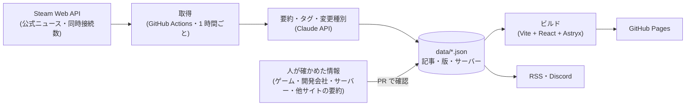

# ROB RUN 日本語アップデート

**https://maco165.github.io/robrun-jp/** (準備中)

ROB RUN の公式アップデートを、日本語で・日本時間で・すぐに届ける、個人の非公式のファンサイトです。
開発元・販売元とは関係ありません。

## 何をまとめるか

| 柱 | 中身 |
|---|---|
| 公式のアップデート | Steam の公式ニュースを 1 時間ごとに取得し、AI (Claude) が日本語で要約する。原文へのリンクを必ず付ける |
| ゲームについて | アーリーアクセスの状況と主な仕組み (ワイプなど) |
| 開発会社について | 開発会社・販売会社と公式の窓口 |
| 公開中のサーバー | いま公開されているサーバーへの外部リンク |

他のサイトの記事は、自動では集めず、選んだ記事を出典 (サイト名・URL・取得日) つきで要約します。

**どの版の情報かを必ず書く。** ROB RUN はアーリーアクセスで、仕様が版ごとに変わります。
記事・ゲームの情報・サーバーの情報のすべてに対象の版を持たせ、いまの版より古い情報には「古い版の情報」と出します。

## 仕組み



## ページ

| 道 | 中身 |
|---|---|
| `/robrun-jp/` | 新サーバーの開放までの残り時間 (EU・East US、日本時間)、最新のお知らせ、これまでのお知らせ |
| `/robrun-jp/news/` | 記事の一覧。タグ・変更の種類・キーワードで絞り込む |
| `/robrun-jp/articles/<id>/` | 記事。日本語の要約・変更点・対象の版・原文へのリンク |

どのページも、作るときに HTML を書き出す (事前描画) ので、JavaScript を動かさない読み手にも中身が届きます。
道は `src/routes.tsx` の 1 か所で決め、画面の振り分けと書き出し (`scripts/prerender.mjs`) の両方がそこを読みます。

## データ

| ファイル | 中身 | 誰が書くか |
|---|---|---|
| `data/news.json` | 記事 (原文の情報・日本語の要約・タグ・変更の種類・対象の版・人が確かめたか) | 取得と要約の仕組み (準備中) |
| `data/versions.json` | 版の一覧 (発売とパッチノート。日時と元のお知らせ) | 人、のちに取得の仕組み |
| `data/schedule.json` | 新サーバーの開放の時刻のきまりと、その出典・更新日 | 人 (公式のお知らせを確かめて) |
| `tests/fixtures/news.json` | 画面の検査だけに使う見本の記事。題に【見本】が付く | 人 |

### 版の決め方

ROB RUN の公式はパッチに版の番号を付けません (2026-11-23 時点の公式のお知らせ 18 件の題と本文に 0 件)。
そこで **公式のお知らせ (発売・パッチノート) が出た日 (日本時間) を版の名前** にします (例 `2026-11-20 版`)。発売より前の情報は `プレイテスト` です。
公式の記事の版は公開された時点の最新の版です。ただし次の版に向けた変更を告げる記事 (発売の直前の変更点の告知など) は、理由 (`versionNote`) を書けば直後の版を付けられます。
他サイトの記事は、扱う中身の版を人が決めます。いまの版より古い記事には【古い版の情報】と出します。決め方は `src/lib/versions.ts` の 1 か所にあります。

見本の記事 (id が `fixture-`) が公開用の `dist` に入ると、`ROBRUN_NEWS` の有無によらず `scripts/prerender.mjs` が止めます。

## 技術

| 項目 | 使うもの |
|---|---|
| 画面 | React 19・Vite・[Astryx](https://github.com/meta/astryx) (Meta の部品集) と独自テーマ `robrun` |
| 書体 | Noto Sans JP (本文と見出し)・Dela Gothic One (サイト名と特集の見出しだけ)・JetBrains Mono。どれも同梱し、外部から読まない |
| 公開 | GitHub Pages (`.github/workflows/deploy.yml`) |

テーマの元は `themes/robrun/` にあり、`npx astryx experimental theme editor set robrun ...` で変えると `src/themes/robrun/` が作り直されます。手で書き換えません。

## 手元で動かす

```bash
npm ci
npm run dev     # http://localhost:5173/robrun-jp/
npm run build   # dist/ に書き出す (画面・事前描画の入口・ページごとの HTML の順)
npm test        # 単体テスト (版の決め方・データの検査)
npm run check:data  # data/ の検査 (版の一覧と記事の版)
npm run e2e     # 見本の記事で dist-e2e/ に組み、1280px と 390px で各ページを開いて確かめる
```

`npm run e2e` は、事前描画の HTML に見出しがあること、横にはみ出さないこと、ページのエラーが無いこと、
記事に「AI による要約」と原文のリンクがあることを確かめます。CI (`.github/workflows/deploy.yml`) でも PR ごとに走ります。

## 方針

- パッチノートの全文の翻訳・転載はしない。短い要約と原文へのリンクにする
- 他のサイトから自動で取得 (スクレイピング) しない
- 公式のロゴやアートワークは、開発元の方針を確かめるまで使わない
- 日本語化 MOD は配らず、案内もしない (アンチチートによる BAN の危険があるため)
- 要約には「AI による要約」と書き、人が確かめたかどうかを記事ごとに持つ

## ライセンス

コードは MIT ([LICENSE](LICENSE))。ROB RUN の名称と内容の権利は開発元・販売元にあります。
