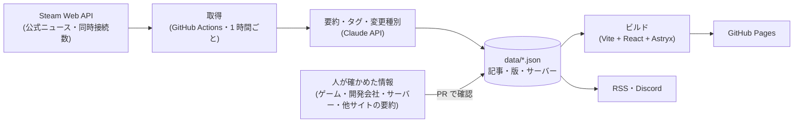

# ROB RUN 日本語アップデート

**https://maco165.github.io/robrun-jp/** (準備中)

ROB RUN の公式アップデートを、日本語で・日本時間で・すぐに届ける、個人の非公式のファンサイトです。
開発元・販売元とは関係ありません。

## 何をまとめるか

| 柱 | 中身 |
|---|---|
| 公式のアップデート | Steam の公式ニュースを 1 時間ごとに取得し、AI (Claude) が日本語で要約する。原文へのリンクを必ず付ける |
| ゲームについて | アーリーアクセスの状況と主な仕組み (ワイプなど) |
| 開発会社について | 開発会社・販売会社と公式の窓口 |
| 公開中のサーバー | いま公開されているサーバーへの外部リンク |

他のサイトの記事は、自動では集めず、選んだ記事を出典 (サイト名・URL・取得日) つきで要約します。

**どの版の情報かを必ず書く。** ROB RUN はアーリーアクセスで、仕様が版ごとに変わります。
記事・ゲームの情報・サーバーの情報のすべてに対象の版を持たせ、いまの版より古い情報には「古い版の情報」と出します。

## 仕組み



## 技術

| 項目 | 使うもの |
|---|---|
| 画面 | React 19・Vite・[Astryx](https://github.com/meta/astryx) (Meta の部品集) と独自テーマ `robrun` |
| 書体 | Noto Sans JP (本文と見出し)・Dela Gothic One (サイト名と特集の見出しだけ)・JetBrains Mono。どれも同梱し、外部から読まない |
| 公開 | GitHub Pages (`.github/workflows/deploy.yml`) |

テーマの元は `themes/robrun/` にあり、`npx astryx experimental theme editor set robrun ...` で変えると `src/themes/robrun/` が作り直されます。手で書き換えません。

## 手元で動かす

```bash
npm ci
npm run dev     # http://localhost:5173/robrun-jp/
npm run build   # dist/ に書き出す
```

## 方針

- パッチノートの全文の翻訳・転載はしない。短い要約と原文へのリンクにする
- 他のサイトから自動で取得 (スクレイピング) しない
- 公式のロゴやアートワークは、開発元の方針を確かめるまで使わない
- 日本語化 MOD は配らず、案内もしない (アンチチートによる BAN の危険があるため)
- 要約には「AI による要約」と書き、人が確かめたかどうかを記事ごとに持つ

## ライセンス

コードは MIT ([LICENSE](LICENSE))。ROB RUN の名称と内容の権利は開発元・販売元にあります。
